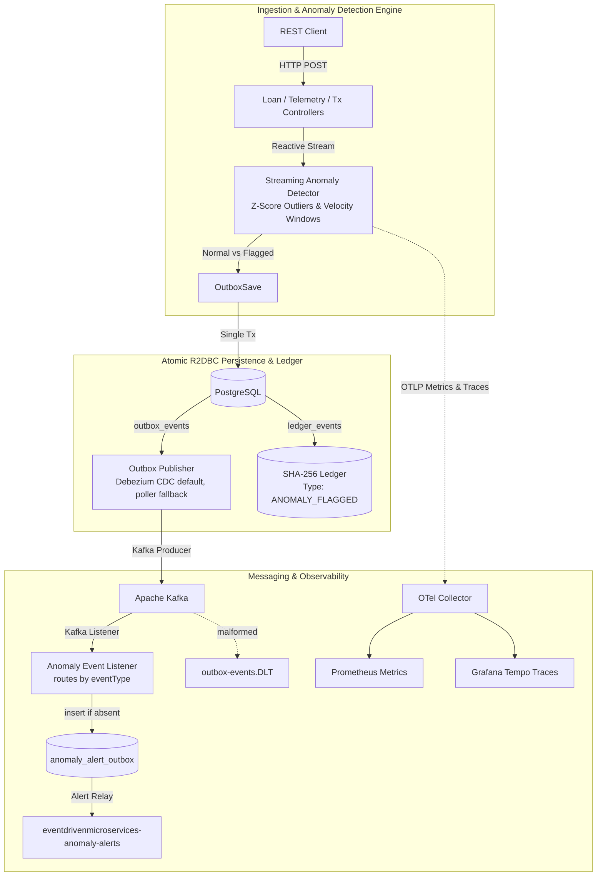

# Event-Driven Microservices Lab

## Project Documentation

- **[Architecture](docs/architecture.md)**: Implemented system boundaries, event flow, and current limitations.
- **[Engineering Guide](docs/engineering-guide.md)**: Setup, verification evidence, limitations, and the canonical next steps.

A hands-on engineering lab demonstrating event-driven distributed systems architecture, reactive streaming anomaly detection, PostgreSQL Transactional Outbox, Apache Kafka event streaming, and Kubernetes deployment.


## 🏛️ System Architecture



### Core Components

1. **`apps/platform-engine` (Java 21 / Spring Boot 3 / WebFlux / R2DBC)**:
   - Non-blocking reactive HTTP ingestion API.
   - **Streaming Anomaly Detection Engine**: In-memory sliding window calculating transaction velocity bursts and telemetry Z-Score metric outliers.
   - **Transactional Outbox Pattern**: Persists domain entities (`loan_applications`, `telemetry_events`, `financial_transactions`) alongside `outbox_events` and trigger-protected, hash-chained `ledger_events` (verify via `GET /api/v1/ledger/verify`) using PostgreSQL R2DBC.
   - **Outbox Publisher**: `OUTBOX_PUBLISHER_MODE=cdc` (default) runs the Debezium bridge: PostgreSQL WAL, Debezium, shadow topic, bridge, canonical topic. `poller` runs a leased, retrying scheduled relay (5 s cadence) and remains as a fallback for environments without Debezium. The two are mutually exclusive.
   - **Kafka Listener**: Validates the version-1 envelope, routes anomaly event types, durably records an alert intent in `anomaly_alert_outbox` (idempotent on redelivery), and sends malformed records to the `.DLT` topic. A relay publishes intents to `eventdrivenmicroservices-anomaly-alerts` with backoff.

2. **`deploy/helm`**:
   - Helm chart packaging the platform-engine alongside infrastructure services (Kafka, Zookeeper, PostgreSQL, Redis, OpenTelemetry Collector, Prometheus, Grafana, Tempo, Loki).
   - Configured with security contexts, init containers, and HPA for production-like deployment on local `kind` clusters.

---

## 🛠️ Key Architectural Patterns Demonstrated

- **Streaming Anomaly Detection**:
  - **Financial Velocity Anomaly**: Detects rapid high-value transactions from the same account within a sliding temporal window ($> \$10,000$ in 5s or $>5$ tx/s).
  - **Telemetry Z-Score Outlier**: Computes rolling mean ($\mu$) and standard deviation ($\sigma$) to flag statistical outliers ($Z = \frac{|x-\mu|}{\sigma} > 3.0$).
- **Transactional Outbox Pattern**: Enforces dual-write consistency by persisting business state and event records in a single database transaction prior to asynchronous Kafka publishing.
- **Reactive Non-Blocking Core**: Built on Spring WebFlux, Project Reactor, and R2DBC to maximize vertical I/O throughput without thread-per-request bottlenecks.
- **Cryptographic Ledger**: SHA-256 hash-chained `ledger_events` table, serialized by an advisory lock, immutable via database triggers, with an on-demand verification endpoint.
- **Debezium CDC (default publisher)**: Helm deploys Connect and a registration Job (`poll.interval.ms=50`). CI `cdc-drill` verifies delivery, connector restart, Connect pod loss, platform-pod loss, end-to-end latency (p50 69 ms, p95 105 ms over 20 samples, run 38189122766) and the monitoring signals.
- **Distributed Tracing & Monitoring**: OpenTelemetry (OTLP) metrics and trace exemplars routed to Prometheus and Grafana Tempo via the OTel Collector.
- **Kubernetes Deployment Hardening**: Security contexts (non-root, read-only filesystem), init containers for dependency readiness, and HPA autoscaling.

---

## 🚀 Quick Start & Centralized Harness

### Prerequisites
- Java 21 & Gradle 8.4
- Helm 3+ & kubectl
- Kind & OpenTofu/Terraform (>= 1.6; `tehcyx/kind` provider ~> 0.11, lock file committed)
- Docker or Podman (for local cluster execution)

### Centralized Build & Boot Script

Run the single entry-point script to validate the toolchain, run Gradle tests, provision the local Kind cluster, and deploy the Helm chart:

```bash
./scripts/start-all.sh
```

*(On Windows PowerShell, use `./scripts/start-all.ps1`)*

### Accessing & Testing the Platform

1. **Port-Forward the Platform Control Room UI & REST API**:
   ```bash
   kubectl port-forward svc/platform-engine 8080:8080
   ```
   Navigate to `http://localhost:8080/` in your browser. Log in with `admin` and the local password (`local-dev-password` unless you set `SPRING_SECURITY_USER_PASSWORD`; the form no longer pre-fills it) to use the interactive loan, transaction, telemetry, outbox, and ledger control room.

2. **Port-Forward the Grafana Observability Dashboard**:
   ```bash
   kubectl port-forward svc/eventdrivenmicroservices-grafana 3000:3000
   ```
   Navigate to `http://localhost:3000` to inspect live application metrics, anomaly rate histograms, and trace exemplars.

3. **Execute the Automated Five-Minute Demo**:
   ```bash
   ./scripts/demo.sh
   ```

---

## 🧪 Testing

- **Java tests**:
  ```bash
  cd apps/platform-engine
  ./gradlew test
  ```
   The latest recorded result and Docker/Testcontainers caveats are in the [engineering guide](docs/engineering-guide.md).

## Current Limitations

- The project is a modular monolith. Debezium CDC is the default publisher (the 5 s poller remains an opt-in fallback). CDC latency is measured in CI at roughly 100 ms p95 on a Kind cluster, not the sub-5 ms sometimes quoted for CDC; the drill gates p95 at 500 ms.
- Delivery is at-least-once, not exactly-once. The anomaly listener deduplicates durable alert intents by `eventId`, but downstream alert consumers must also deduplicate. A deterministic live test of the CDC publish-acknowledged/`processed`-update crash window remains outstanding; current focused coverage for that precise failure is mocked.
- Bearer tokens are validated for HS256 signature, `exp`, `nbf`, and optional issuer/audience (`JWT_ISSUER`, `JWT_AUDIENCE`) and grant no authorities. Keys rotate without downtime: set the new `JWT_SECRET_KEY` and put the old one in `JWT_SECRET_KEY_PREVIOUS` (comma-separated), then remove it once old tokens have expired. There is no `kid` header and no token issuer. HTTP-level behavior is covered by `BearerAuthenticationHttpTest`.
- The ledger is hash-chained, serialized with an advisory lock, protected by database triggers that reject UPDATE/DELETE/TRUNCATE, and checkable via `GET /api/v1/ledger/verify`. `GET /api/v1/ledger` is bounded by `?limit=` and `GET /api/v1/ledger/verify?recent=N` checks only the latest N events (it cannot detect tampering before the window). The default full verification still reads the whole table (no checkpoints), and a database superuser can still disable the triggers.
- Flyway V6 migrates existing telemetry rows to UTC-hour partitions. The hourly purge drops complete partitions once their full hour is beyond the seven-day cutoff, so managed timestamps have at most about one extra hour of retention. Out-of-range timestamps land in a default partition and expired overflow rows are explicitly row-deleted there (with a warning); that exceptional path is not a cold drop. V6 locks and rewrites the table once, so larger deployments need a tested maintenance window. The scheduled job has no multi-replica leader election.
- The Helm PostgreSQL workload uses a PersistentVolumeClaim and remains single-replica, with no scheduled or off-site backups and no HA. `scripts/postgres-backup-verify.sh` can export a custom-format archive to an operator-selected local path and restore it into a temporary database to check representative table counts; it does not provision a durable backup destination or retention schedule. The chart is a local lab deployment, not a production-ready data platform.
- Docker-backed integration tests need a Docker daemon compatible with the pinned Testcontainers; without one they may be skipped locally. If your daemon requires a newer API version, set `api.version=1.44` in `~/.docker-java.properties`. CI enforces that these integration tests are not skipped.
- The CDC drill verifies that the HTTP, ledger, CDC publish, and consumer spans share one Tempo trace, and exercises connector restart/Connect pod recovery. This does not yet verify live Kafka outage recovery or the precise CDC publish/`processed` crash window. The control room has no trace link or joined event timeline. Its Playwright/Chromium test covers authenticated loan submission and transaction-anomaly evidence, not every UI workflow or loading/error/empty states. Live Grafana panel queries and Redis outage recovery also remain unverified.
- `local-dev-password` is a local fallback credential for non-Kubernetes runs only. The `k8s` profile (Helm) now refuses to start if the admin or database password is blank or the fallback; the chart reads the admin password from secret key `ADMIN_PASSWORD`. `scripts/start-all.*` now generates any missing chart secret keys (not yet run end to end; the PowerShell version is untested).

## Five-Minute Demo

Start the application locally or port-forward the deployed service to `localhost:8080`, then run:

```powershell
./scripts/demo.ps1
```

On Bash-compatible systems:

```bash
./scripts/demo.sh
```

The demo submits a loan, sends a normal transaction, sends a six-transaction velocity burst, and reads the outbox backlog plus ledger hash evidence. It does not provision infrastructure; use `scripts/test-local.ps1` or `scripts/test-local.sh` first when running against Kind.

The browser control room is available at `http://localhost:8080/` when the application is running. Enter the operator credentials, submit a loan, send a transaction burst, establish a telemetry baseline, inject a CPU outlier, and refresh the evidence panel to inspect the current ledger and outbox state. Each API response exposes `X-Correlation-Id` and, when an active span exists, `X-Trace-Id`.

---

## 📦 Tech Stack

| Technology | Role |
|---|---|
| Java 21 | Application runtime |
| Spring Boot 3 (WebFlux) | Reactive REST framework |
| PostgreSQL 15 (R2DBC) | Primary data store + Outbox + Ledger |
| Apache Kafka | Event streaming broker & CEP listener |
| Debezium | CDC connector for WAL-based outbox |
| Redis | Distributed caching and idempotency |
| Kubernetes (kind) | Container orchestration |
| Helm 3 | Kubernetes package management |
| Terraform | Infrastructure provisioning |
| Prometheus | Metrics collection & anomaly alerting |
| Grafana + Tempo + Loki | Dashboards, tracing, and log aggregation |
| OpenTelemetry | Distributed observability pipeline |
