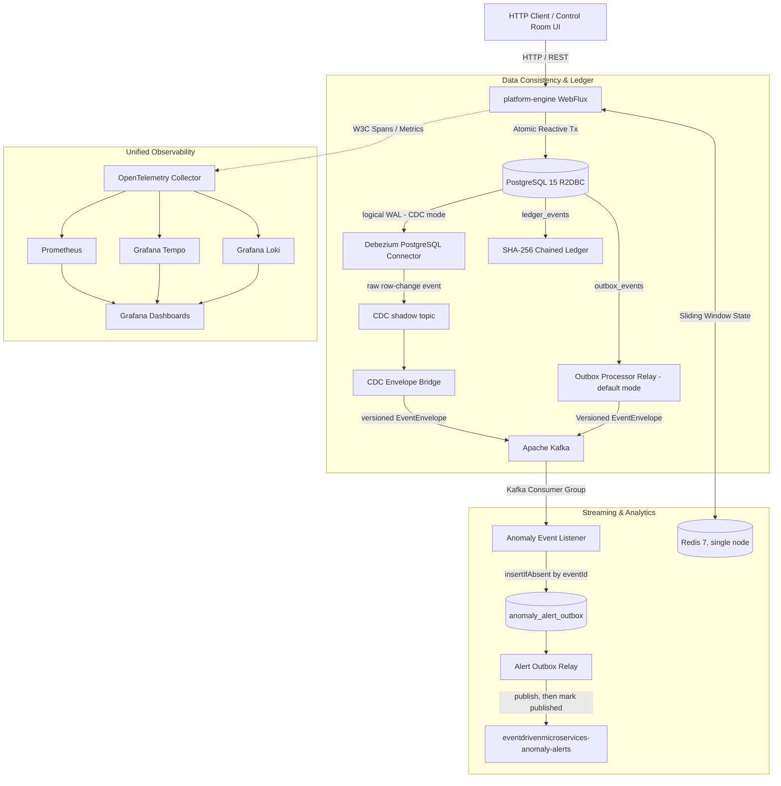

# EventDrivenMicroservices System Architecture

**Status:** Official System Architecture Specification  
**Version:** 2.0  
**Related Documents:** [engineering-guide.md](engineering-guide.md), [README.md](../README.md)

This document describes the implementation, not a target production architecture. The project is a single Spring application deployed with local supporting infrastructure. Current build/test evidence and remaining work are tracked in [engineering-guide.md](engineering-guide.md).

---

## 1. System Topology

The platform operates as an observable modular monolith deployed to Kubernetes via Helm. All core financial ingestion, outbox dispatch, stream processing, anomaly detection, and cryptographic ledgering run within `platform-engine`, backed by PostgreSQL, Redis, and Apache Kafka.



---

## 2. Ingestion & API Layer

The HTTP layer uses Spring WebFlux and is protected by HTTP Basic and a custom HMAC Bearer-token check. Bearer tokens must be HS256 JWTs with a valid signature, a numeric `exp` (30 s clock skew), an optional `nbf`, and, when `JWT_ISSUER` / `JWT_AUDIENCE` are set, matching `iss` / `aud`. The `sub` claim becomes the principal (default `eventdrivenmicroservices-edge-node`). Bearer tokens grant no authorities, so they can call authenticated ingestion endpoints but never the `ADMIN`-only `/actuator/**`. Rotation: the new secret goes in `JWT_SECRET_KEY` and retired ones in `JWT_SECRET_KEY_PREVIOUS` (comma-separated, optional chart secret key) until their tokens expire. There is no `kid` header and no token issuer.

* `POST /api/v1/loans`: Ingests loan origination applications, validates applicant UUIDs and dynamic loan tier properties, persists the loan, creates an outbox event, and appends an `ApplicationSubmitted` record to the SHA-256 ledger.
* `POST /api/v1/transactions`: Ingests financial transactions, evaluates real-time sliding-window velocity thresholds, and dual-writes transaction state with outbox events.
* `POST /api/v1/telemetry`: High-throughput telemetry ingestion evaluating rolling Z-score outliers ($Z > 3.0$).
* `GET /api/v1/ledger`: Retrieves chronological ledger event history with hash proofs.
* `GET /api/v1/ledger/latest-hash`: Exposes the latest cryptographic head of the SHA-256 chain.
* `GET /api/v1/ledger/verify`: Recomputes the full chain in append order and returns `valid`, `eventsChecked`, and the first invalid event ID and reason, if any. Optional `?recent=N` limits it to the latest N events (response `scope`). `ConnectorStateMonitor` polls Kafka Connect and exposes connector/task gauges that drive the `DebeziumConnectorNotRunning` and `DebeziumTaskFailed` alerts.
* `GET /api/v1/outbox/status`: Returns current outbox backlog depth, oldest unprocessed record timestamp, and queue age.
* `GET /`: Interactive web control room serving static WebFlux resources for operators and live demos. A Playwright/Chromium integration test exercises loan submission and transaction-anomaly evidence through the browser.

### Context Propagation
Every HTTP response includes an `X-Correlation-Id` header (generated or preserved from client requests) and an `X-Trace-Id` header when the filter observes an active OpenTelemetry span. End-to-end trace continuity is not currently verified.

---

## 3. Transactional Outbox Pattern

To provide at-least-once delivery without distributed two-phase commit:
1. **Atomic Dual-Write:** The business entity and the corresponding outbox record are committed together in a single PostgreSQL R2DBC transaction.
2. **Selectable Publisher:** `OUTBOX_PUBLISHER_MODE` is `cdc` by default. In opt-in `poller` mode, a background publisher queries pending events in batches of up to 50, claims leases, publishes sequentially, and isolates per-event failures with capped exponential retry delay. In the default `cdc` mode, PostgreSQL logical replication feeds Debezium's insert-only shadow topic; the CDC bridge maps the row to the same envelope and canonical topic, waits for Kafka acknowledgement, then sets `processed` to mean published (not consumer-processed). The two publishers are mutually exclusive.
3. **Kafka Header Injection:** When present, the stored W3C `traceparent` is injected into the Kafka record header. This is partial propagation, not a verified end-to-end trace.
4. **Contract Envelope:** Payloads are serialized using the current `EventEnvelope` schema (`eventVersion`):
   ```json
   {
    "eventId": "uuid",
    "eventType": "ApplicationSubmitted",
    "eventVersion": 1,
    "aggregateType": "LoanApplication",
    "aggregateId": "11111111-1111-4111-8111-111111111111",
    "traceparent": "00-4bf92f3577b34da6a3ce929d0e0e4736-00f067aa0ba902b7-01",
    "occurredAt": "2026-09-14T19:11:00.437Z",
    "payload": "{...}"
   }
   ```

  CDC's canonical publish and the subsequent `processed` update are not a distributed transaction. If the bridge publishes and then fails before updating PostgreSQL, replay can publish the same event again; consumers must deduplicate by stable `eventId`. Connector restart/replay and consumer idempotency are not yet verified.

---

## 4. Cryptographic Ledgering

The ledger stores hash-linked records for loan submissions and selected anomaly events:
* **Genesis Hash:** Rooted at deterministic `64-zero` SHA-256 string (`0000000000000000000000000000000000000000000000000000000000000000`).
* **Hash Chaining:** Each record calculates:
  $$\text{current\_hash} = \text{SHA-256}(\text{previous\_hash} + \text{transaction\_type} + \text{payload})$$
* **Serialized appends:** `appendToLedger` takes a transaction-scoped PostgreSQL advisory lock before reading the head, so concurrent appends (including across replicas) form one chain. A unique `seq` identity column (migration `V5`) defines chain order; `created_at` is not used for ordering.
* **Append-only enforcement:** database triggers reject `UPDATE`, `DELETE`, and `TRUNCATE` on `ledger_events`. A unique index on `previous_hash` additionally prevents forks. A database superuser can still disable triggers, so this deters application-level mutation rather than a privileged attacker.
* **Verification:** `GET /api/v1/ledger/verify` recomputes every hash and link in append order. It streams the whole table (no checkpoints yet); `?recent=N` verifies only the latest N events and cannot see earlier tampering, and `GET /api/v1/ledger` is bounded by `?limit=`. It detects tampering only after the fact. Retention of ledger rows must be designed around the append-only triggers.

---

## 5. Streaming Anomaly Detection Engine

The anomaly detection engine runs in-process with dual-backend state management:
* **Financial Velocity Anomaly:** Flags a five-second window when transaction count reaches five or the summed amount exceeds $10,000. State uses Redis when available, with a per-process in-memory fallback that is not shared across replicas.
* **Telemetry Z-Score Outlier:** Calculates rolling mean ($\mu$) and standard deviation ($\sigma$) from prior readings (up to 20), flagging an observation where:
  $$Z = \frac{|x - \mu|}{\sigma} \ge 3.0$$
* **Kafka anomaly listener:** Parses `EventEnvelope` and routes only recognized anomaly `eventType` values. It persists a PostgreSQL alert intent keyed by `eventId` before returning; a leased relay publishes the intent to the alert topic and marks it delivered only after Kafka acknowledgement. Repeated input events create one intent. Malformed or unsupported envelopes go to a seven-day dead-letter topic with original Kafka coordinates; transient listener failures retry with a one-second interval. Delivery remains at-least-once: a relay crash after Kafka acknowledgement but before the database update can duplicate an alert, so downstream alert consumers must deduplicate by `eventId`. This is not a rules-based CEP engine.

---

## 6. Observability & Infrastructure

The local lab stack is packaged in the canonical Helm chart `deploy/helm/event-driven-lab`:
* **OpenTelemetry Collector:** Central gateway receiving OTLP gRPC/HTTP signals on ports 4317 and 4318.
* **Grafana Tempo:** Distributed trace storage supporting traceparent lookups.
* **Prometheus:** Metrics scraping endpoint monitoring throughput, JVM metrics, and custom anomaly counters.
* **Grafana Loki:** Centralized log aggregation across all Kubernetes pods.
* **Grafana:** Dashboards pre-provisioned with Prometheus, Tempo, and Loki datasources.
* **Local deployment status:** The platform container runs non-root with a read-only root filesystem and external database/JWT secret references. PostgreSQL is a single-replica Deployment backed by a PersistentVolumeClaim (`postgres.persistence`, default 5Gi; a pod-replacement durability drill passes in CI) but has no backups or HA; several infrastructure images use `latest`, and not all pods have probes or equivalent hardening. Treat this chart as a local lab, not production-ready deployment configuration.
Current verification evidence and implementation priorities live in [engineering-guide.md](engineering-guide.md).
